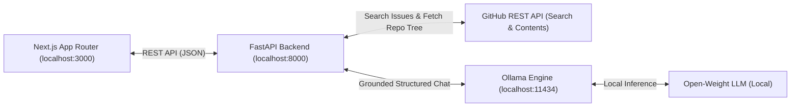

# 🧭 OpenSource Navigator AI

> **Your AI guide to your first open-source contribution.**  
> *Built for Hacktoberfest Hack Day Pune × NIAT–ADYPU — Best Open-Source AI Project.*

[](LICENSE)
[](https://fastapi.tiangolo.com)
[](https://nextjs.org)
[-purple.svg)](https://ollama.com)
[](https://microsoft.com)

---

## 🌟 Overview

Contributing to open source for the first time can be intimidating. Beginners are often overwhelmed by massive codebases, cryptic issue descriptions, and unfamiliar workflows.

**OpenSource Navigator AI** empowers students and first-time contributors by:
1. **Discovering Real Public GitHub Issues:** Live search filtered by language, topic, tags (such as `good first issue` and `help wanted`), and target repository (`owner/repo`), with full page pagination and pull-request exclusion.
2. **Repository-Aware Open-Weight AI Analysis:** Running local inference via **Ollama** (`deepseek-r1:8b`, `qwen3:4b`, etc.) grounded in real repository layouts. Distinguishes between **Verified Repository Files** and **Hypotheses**, generating plain-English summaries, honest contributor difficulty ratings, and maintainer clarification questions tailored to the contributor's skill level (`Beginner`, `Intermediate`, `Advanced`).
3. **Customizable Contribution Roadmaps & PR Export:** Turning AI insights into an interactive checklist (Preparation, Investigation, Implementation, Testing, PR prep). Contributors can add custom tasks, delete tasks, and **Export to Markdown** with 1-click to paste directly into GitHub issue comments and PR descriptions!
4. **Zero Paid APIs or Cloud Lock-in:** 100% functional with local open-weight AI models.

---

## 🏗️ Architecture



---

## 🚀 Quick Start Guide (Windows PowerShell)

### Prerequisites
- **Node.js** v18+ (tested on Node v24)
- **Python** 3.10+ (tested on Python 3.10.11)
- **Git**
- **Ollama** ([Download from Ollama.com](https://ollama.com))

### 1. Run Automated Setup
Open Windows PowerShell in the project directory and run:

```powershell
cd D:\OpenSourceNavigatorAI
.\scripts\setup.ps1
```

The setup script automatically:
- Verifies Python, Node.js, npm, Git, and Ollama.
- Inspects disk space and explains model storage options.
- Creates `backend\.env` and `frontend\.env.local` if missing.
- Sets up the Python virtual environment in `backend\.venv` and installs dependencies.
- Installs frontend npm packages.
- Checks local Ollama connectivity.

### 2. Launch Services
Start both backend (port 8000) and frontend (port 3000):

```powershell
.\scripts\run.ps1
```

Access the application:
- 🌐 **Frontend Dashboard:** [http://localhost:3000](http://localhost:3000)
- ⚙️ **FastAPI Swagger Docs:** [http://localhost:8000/docs](http://localhost:8000/docs)
- 🩺 **Health Endpoint:** [http://localhost:8000/api/v1/health](http://localhost:8000/api/v1/health)

### 3. Run Smoke Tests
Verify all endpoints and integrations:

```powershell
.\scripts\smoke-test.ps1
```

### 4. Stop Services
When finished:

```powershell
.\scripts\stop.ps1
```

---

## 🔧 Environment Configuration

### Backend (`backend/.env`)
| Variable | Default | Description |
|---|---|---|
| `GITHUB_TOKEN` | *(optional)* | GitHub Personal Access Token to raise rate limits from 60 to 5,000 req/hr. |
| `OLLAMA_BASE_URL` | `http://localhost:11434` | URL of the local Ollama daemon. |
| `OLLAMA_MODEL` | `deepseek-r1:8b` | Configurable open-weight model name (e.g. `qwen3:4b`, `deepseek-r1:8b`). |
| `FRONTEND_ORIGIN` | `http://localhost:3000` | Allowed CORS origin for frontend requests. |

### Frontend (`frontend/.env.local`)
| Variable | Default | Description |
|---|---|---|
| `NEXT_PUBLIC_API_BASE_URL` | `http://localhost:8000` | Points to the FastAPI backend API. |

> 🔒 **Security Notice:** Never commit `.env` or `.env.local` files to version control. They are strictly ignored by `.gitignore`.

---

## 🧪 Testing

Automated unit and integration tests are located in `backend/tests`:

```powershell
cd D:\OpenSourceNavigatorAI\backend
.\.venv\Scripts\Activate.ps1
pytest -v
```

### Test Coverage
- **Health Check:** Ensures system status is reported without leaking secrets.
- **GitHub Client:** Tests query building (with `repo:` qualifiers), label escaping, pull request filtering, pagination (`page`), repository structure discovery, rate limit detection, and network timeouts.
- **Ollama Client:** Tests markdown fence parsing, deep reasoning tag stripping (`<think>...</think>`), repository layout grounding, schema validation, and offline recovery.
- **API Endpoints:** Request validation, pagination boundaries, and error responses.

---

## 🛡️ Security & Open-Source Principles

1. **Untrusted Input Handling:** GitHub issues are untrusted third-party text. The backend isolates issue content and ensures the model is not given access to shell execution or automatic git push operations.
2. **Explicit Hypotheses & Verification:** The AI distinguishes between confirmed repository files (retrieved safely via GitHub Contents API) and hypothetical paths.
3. **Rate-Limit Resilience:** In-memory caching shields GitHub's API, and polite error banners instruct users how to configure a personal token if unauthenticated limits are reached.

---

## 📦 Model Attribution & Licenses

- **Ollama:** Open-source local inference engine ([MIT License](https://github.com/ollama/ollama/blob/main/LICENSE)).
- **Supported Models:** 
  - `deepseek-r1:8b` (DeepSeek-AI open weights)
  - `qwen3:4b` / `qwen2.5:3b` (Alibaba Cloud open weights)
- **Application Code:** [MIT License](LICENSE).

---

## 🗺️ Demo Script

A detailed 3-minute hackathon presentation script is provided in [`docs/demo-script.md`](docs/demo-script.md).
