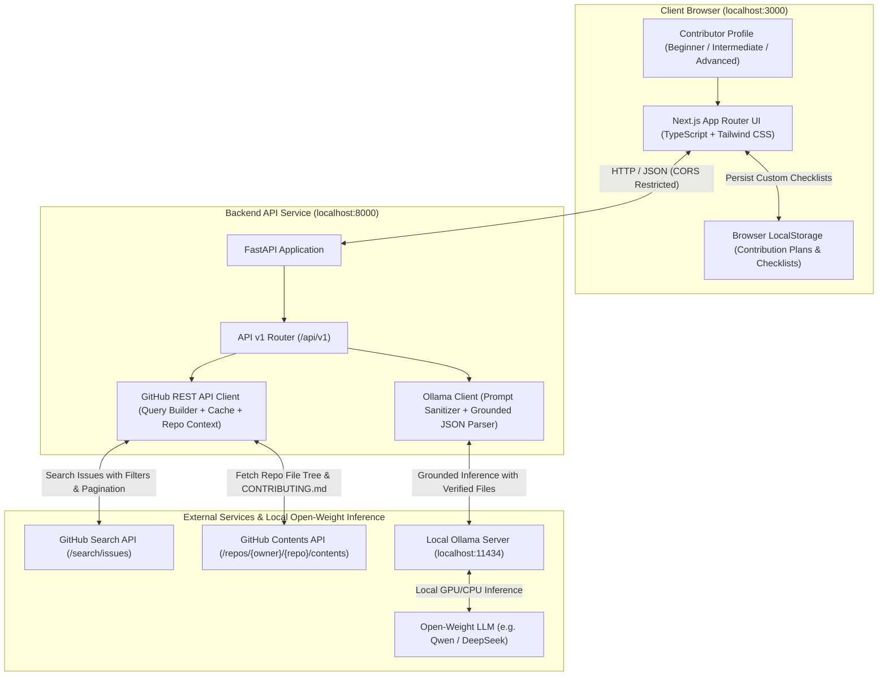

# OpenSource Navigator AI — System Architecture

**OpenSource Navigator AI** is a full-stack, open-weight AI web application engineered for students and beginner developers making their first open-source software contributions.

---

## 1. High-Level Architecture Diagram

---

## 2. Component Breakdown

### Frontend (`/frontend`)
- **Framework:** Next.js 16 with App Router, React 19, TypeScript.
- **Styling:** Tailwind CSS (Dark developer palette, responsive layout, fluid typography).
- **Icons:** Lucide React icons.
- **State Management & Persistence:**
  - Dynamic tab navigation (`Discover Issues`, `AI Issue Analyzer`, `My Contribution Plans`, `About`).
  - Search debouncing (500ms) across keywords and specific repositories (`owner/repo`).
  - Page pagination bar (Previous, Next, Page jumping).
  - Contributor skill level selector (`Beginner`, `Intermediate`, `Advanced`).
  - In-app issue details expander for quick inline reading.
  - Client-side persistence using `localStorage` for contribution checklists.
  - Custom task additions, task deletions, and 1-click **Markdown Export** (`Copy MD` and `Download .md`).

### Backend (`/backend`)
- **Framework:** Python 3.10+ with FastAPI.
- **Data Validation:** Pydantic models for strict payload validation.
- **Asynchronous HTTP Client:** HTTPX with connection pooling and timeouts.
- **Testing:** Pytest with asynchronous test suites and mocks.

### GitHub Integration (`app.clients.github_client`)
- Interacts with GitHub Issue Search endpoint (`https://api.github.com/search/issues`).
- Statically forces `is:issue` and filters out pull requests (`"pull_request"` objects).
- Supports filtering by repository (`repo:owner/name`), language, label, keywords, and pagination (`page`, `per_page`).
- **Repository-Aware Context Retrieval:** Inspects repository root directory (`GET /repos/{owner}/{repo}/contents`) to fetch top-level directories, files, and `CONTRIBUTING.md` links.
- In-memory cache with 120-second TTL to guard against redundant API calls.
- Graceful rate-limit detection with reset countdown and token configuration instructions.

### Open-Weight AI Inference (`app.clients.ollama_client`)
- Communicates directly with local Ollama HTTP API (`http://localhost:11434`).
- Uses zero paid cloud APIs: runs 100% locally on open-weight models (`deepseek-r1:8b`, `qwen3:4b`, etc.).
- Robust JSON extraction handling `<think>` reasoning tags and markdown code blocks.
- **Repository-Grounded Validation:** Distinguishes between **Verified Repository Files** (confirmed to exist in repository layout) and **Hypotheses** (unverified file paths).
- Tailors explanations and investigation roadmaps to the contributor's self-assessed skill level.

---

## 3. Security & Safety Posture

1. **Untrusted Input Isolation:** Issue descriptions and titles from GitHub are treated as untrusted user input. They are encapsulated strictly within delimiter markers and never injected as raw system prompt instructions.
2. **Zero Credential Leakage:** Optional `GITHUB_TOKEN` values are kept strictly server-side in environment variables and are never surfaced to the client or committed to Git.
3. **Explicit Verification vs Hypothesis:** The AI analyzer transparently flags unverified files as hypotheses while citing verified files that actually exist in the target repo.
4. **No Code Execution:** The system never executes code from untrusted repositories or submits automatic pull requests.
