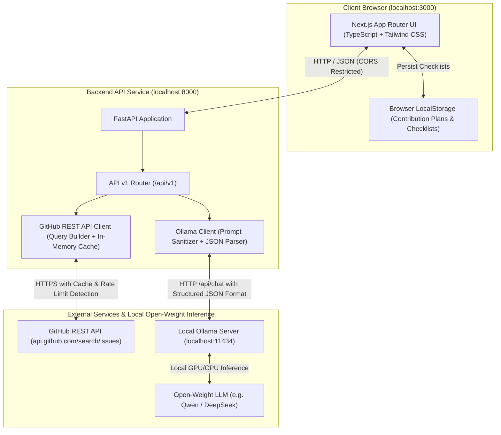

# OpenSource Navigator AI — System Architecture

**OpenSource Navigator AI** is a full-stack, open-weight AI web application engineered for students and beginner developers making their first open-source software contributions.

---

## 1. High-Level Architecture Diagram

---

## 2. Component Breakdown

### Frontend (`/frontend`)
- **Framework:** Next.js 16 with App Router, React 19, TypeScript.
- **Styling:** Tailwind CSS (Dark developer palette, responsive layout, fluid typography).
- **Icons:** Lucide React icons.
- **State Management & Persistence:**
  - Dynamic tab navigation (`Discover Issues`, `AI Issue Analyzer`, `My Contribution Plans`, `About`).
  - Search debouncing (500ms) to prevent GitHub rate-limiting.
  - Client-side persistence using `localStorage` for contribution checklists.

### Backend (`/backend`)
- **Framework:** Python 3.10+ with FastAPI.
- **Data Validation:** Pydantic models for strict payload validation.
- **Asynchronous HTTP Client:** HTTPX with connection pooling and timeouts.
- **Testing:** Pytest with asynchronous test suites and mocks.

### GitHub Integration (`app.clients.github_client`)
- Interacts with GitHub Issue Search endpoint (`https://api.github.com/search/issues`).
- Statically forces `is:issue` and filters out pull requests (`"pull_request"` objects).
- In-memory cache with 120-second TTL to guard against redundant API calls.
- Graceful rate-limit detection with reset countdown and configuration instructions.

### Open-Weight AI Inference (`app.clients.ollama_client`)
- Communicates directly with local Ollama HTTP API (`http://localhost:11434`).
- Uses zero paid cloud APIs: runs 100% locally on open-weight models (`deepseek-r1:8b`, `qwen3:4b`, `qwen2.5:3b`, etc.).
- Robust JSON extraction handling `<think>` tags and markdown code blocks.
- Forces hypothesis disclaimers: models never falsely claim to have inspected unprovided files.

---

## 3. Security & Safety Posture

1. **Untrusted Input Isolation:** Issue descriptions and titles from GitHub are treated as untrusted user input. They are encapsulated strictly within delimiter markers and never injected as raw system prompt instructions.
2. **Zero Credential Leakage:** Optional `GITHUB_TOKEN` values are kept strictly server-side in environment variables and are never surfaced to the client or committed to Git.
3. **Explicit Hypothesis Framing:** All recommended code paths and files are clearly tagged as `Hypothesis` since the AI only has access to issue text, not the full codebase.
4. **No Code Execution:** The system never executes code from untrusted repositories or submits automatic pull requests.
